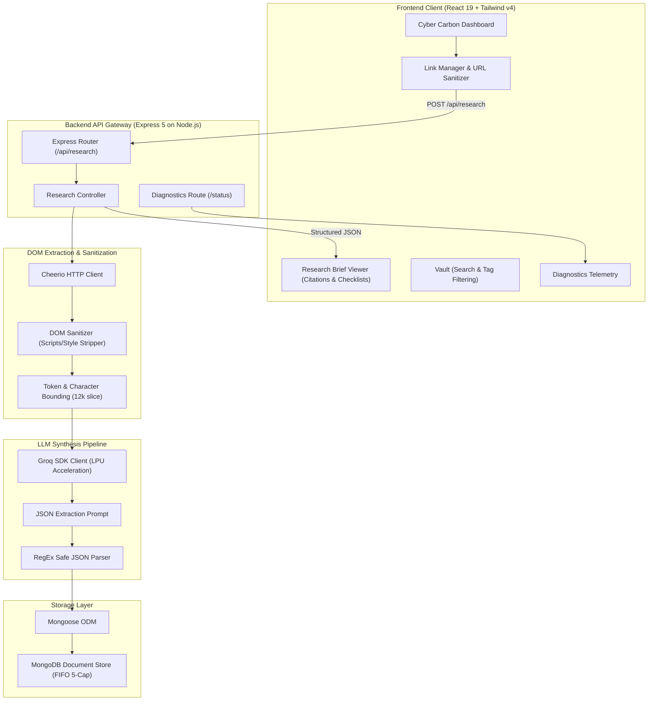

# ResearchBrief | Automated Cross-Source Intelligence Engine

[](https://researchbrief.vercel.app/)
[](https://researchbrief-gg0i.onrender.com/)
[](https://react.dev/)
[](https://vitejs.dev/)
[](https://tailwindcss.com/)
[](https://nodejs.org/)
[](https://www.mongodb.com/)
[](https://groq.com/)

A high-performance full-stack AI research platform that ingests, cleans, cross-references, and synthesizes unstructured web content from up to 5 concurrent sources into structured, actionable intelligence briefs with contradiction detection and citation tracing.

---

## 🌐 Live Production Deployments

- **Web Application:** [https://researchbrief.vercel.app/](https://researchbrief.vercel.app/)
- **API Gateway:** [https://researchbrief-gg0i.onrender.com/](https://researchbrief-gg0i.onrender.com/)
- **System Health Endpoint:** [https://researchbrief-gg0i.onrender.com/status](https://researchbrief-gg0i.onrender.com/status)

---

## 🏛 System Architecture



---

## ⚡ Core Technical Features & Engineering Highlights

### 1. Robust Multi-Source DOM Ingestion
- **Anti-Bot Header Normalization:** Employs standard browser `User-Agent` and `Accept` headers to bypass 403 Forbidden blocks on sites like Wikipedia, Cloudflare-protected endpoints, and news outlets.
- **Aggressive DOM Sanitization:** Utilizes `cheerio` to strip non-content elements (`<script>`, `<style>`, `<noscript>`, `<iframe>`), collapses extraneous whitespace, and normalizes raw text.
- **Context Window Management:** Caps individual sources at 8,000 characters and combined multi-source payloads at 12,000 characters to prevent context window overflow and enforce predictable token throughput.

### 2. High-Speed LPU Synthesis & Prompt Engineering
- **Sub-Second Inference via Groq:** Powered by high-throughput LPU hardware running open weights models (`openai/gpt-oss-20b`), minimizing user wait time during multi-document synthesis.
- **Strict Structured JSON Output:** Custom system prompts with bounded token limits and RegEx JSON block extractors guarantee valid schema output without hallucinatory markdown wrapping.
- **Contradiction & Divergence Analyzer:** Specifically analyzes conflicting data points, disputed timeline dates, or divergent claims across input sources, surfacing them in a dedicated discrepancy alert section.

### 3. Fault-Tolerant & Non-Blocking Persistence
- **Resilient MongoDB Layer:** Uses connection state interrogation (`mongoose.connection.readyState`) with connection timeout safeguards. If the database experiences network latency or disconnects, the synthesis pipeline **does not crash**—the brief is delivered immediately to the client with an ephemeral ID.
- **FIFO Rotation Capping:** Enforces a rolling window of the 5 most recent research briefs, automatically pruning older records upon new successful ingestions.

### 4. Cyberpunk Obsidian UI & Technical Typography
- **Design System:** Deep carbon palette (`#08080a`), electric cyan (`#00f0ff`) and emerald (`#10b981`) glow states, and subtle background grid lines.
- **Dual Typography Hierarchy:** **Space Grotesk** for clean architectural headers and **JetBrains Mono** for claim numbers, telemetry readouts, quoted source snippets, and tag pills.
- **Interactive Fact-Checking:** Client-side interactive audit checkboxes with real-time `X / Y Audited` verification counters.
- **Multi-Format Export Pipeline:** In-browser Markdown generator (`formatBriefToMarkdown`), single-click clipboard copying with visual toast confirmation, `.md` file download, and print-ready stylesheet formatting.

---

## 📡 REST API Reference

### 1. Ingest & Synthesize Research
- **Endpoint:** `POST /api/research`
- **Request Body:**
  ```json
  {
    "links": [
      "https://en.wikipedia.org/wiki/Artificial_intelligence",
      "https://en.wikipedia.org/wiki/Machine_learning"
    ]
  }
  ```
- **Response (`200 OK`):**
  ```json
  {
    "_id": "6acd561e8462fc1a27b38214",
    "links": ["https://en.wikipedia.org/wiki/Artificial_intelligence"],
    "summary": "Executive summary synthesizing key insights across input sources...",
    "keyPoints": [
      {
        "point": "Primary goal of modern AI systems",
        "source": "Wikipedia - Artificial intelligence",
        "snippet": "Artificial intelligence is the capability of computational systems..."
      }
    ],
    "conflicts": [
      "Discrepancy noted regarding projected AGI arrival timelines across researchers."
    ],
    "verifyChecklist": [
      "Confirm initial deployment date of GPT architecture."
    ],
    "tags": ["Artificial Intelligence", "Machine Learning", "Deep Learning"],
    "createdAt": "2026-10-12T21:50:22.565Z"
  }
  ```

### 2. Retrieve Brief History
- **Endpoint:** `GET /api/research`
- **Response (`200 OK`):** Array of up to 5 most recent brief objects, sorted in descending order (`createdAt: -1`).

### 3. Delete Research Brief
- **Endpoint:** `DELETE /api/research/:id`
- **Response (`200 OK`):** `{"success": true, "message": "Research brief deleted"}`

### 4. Telemetry & Health Diagnostics
- **Endpoint:** `GET /status`
- **Response (`200 OK`):**
  ```json
  {
    "server": "Running",
    "database": "Connected",
    "llm": "Connected"
  }
  ```

---

## 🛠 Tech Stack Details

| Layer | Technologies |
|---|---|
| **Client** | React 19, Vite 7, Tailwind CSS v4, Lucide React, Axios |
| **Server** | Node.js (v20+), Express 5, Cors, Dotenv |
| **Scraping** | Cheerio (HTML Parsing & Sanitization) |
| **Inference** | Groq SDK (`openai/gpt-oss-20b` via LPU Hardware) |
| **Database** | MongoDB Atlas / Local MongoDB, Mongoose 9 ODM |
| **Hosting** | Vercel (Client SPA) & Render (REST Web Service) |

---

## 💻 Local Development Setup

### Prerequisites
- Node.js `v18.0.0` or higher
- MongoDB instance (local `mongodb://127.0.0.1:27017` or cloud MongoDB Atlas connection URI)
- Groq Cloud API key ([console.groq.com](https://console.groq.com/))

### 1. Clone the Repository
```bash
git clone https://github.com/Amarshrivastava2201/research-brief.git
cd research-brief
```

### 2. Configure & Launch Backend
```bash
cd backend
npm install
```

Create a `.env` file in `backend/`:
```env
PORT=5000
MONGO_URI=mongodb://127.0.0.1:27017/research_brief
GROQ_API_KEY=gsk_your_groq_api_key_here
```

Start the backend server:
```bash
npm start
# Server will listen on http://localhost:5000
```

### 3. Configure & Launch Frontend
In a new terminal:
```bash
cd frontend
npm install
```

Create a `.env` file in `frontend/`:
```env
VITE_API_URL=http://localhost:5000
```

Start Vite dev server:
```bash
npm run dev
# Frontend ready on http://localhost:5173
```

---

## 🔒 Production Deployment Guide

### Backend (Render)
1. Create a **New Web Service** pointing to your repository.
2. Root Directory: `backend`
3. Build Command: `npm install`
4. Start Command: `npm start`
5. Configure Environment Variables:
   - `MONGO_URI`: `mongodb+srv://<user>:<password>@cluster.mongodb.net/research_brief`
   - `GROQ_API_KEY`: `gsk_...`

### Frontend (Vercel)
1. Import your GitHub repository in Vercel.
2. Root Directory: `frontend`
3. Framework Preset: `Vite`
4. Configure Environment Variable:
   - `VITE_API_URL`: `https://your-backend-app.onrender.com` (no trailing slash)

---

## 📄 License
This project is open-source and available under the [ISC License](LICENSE).
